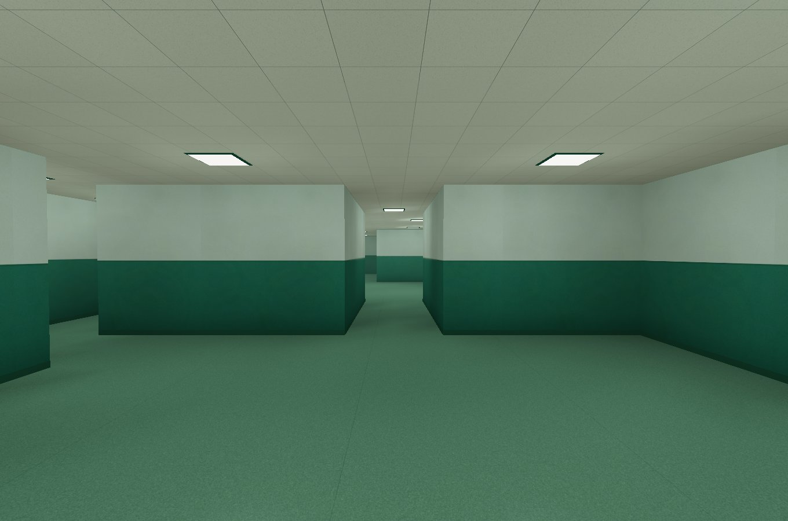
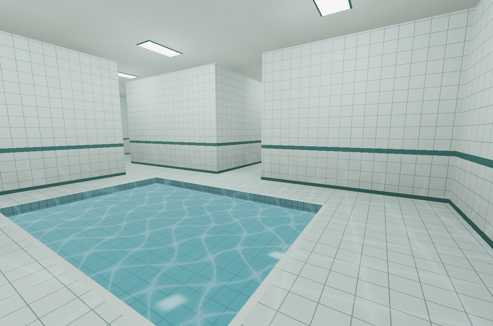

# FLOOR 05

Backrooms esplorabili in prima persona: 26 ambienti collegati su un unico piano, con corridoi, deviazioni e percorsi di ritorno. Tre stili: carta da parati gialla e moquette; ospedale verde a due tonalità; piscine piastrellate con acqua animata.

**[Apri il sito](https://albertogigantelligabriele.github.io/floor-05/)**. Clicca nella scena per catturare il mouse, usa WASD per camminare, Maiusc per accelerare ed Esc per liberare il puntatore. M attiva/disattiva il suono.

Su iPhone/iPad e dispositivi touch: tieni premuto **Cammina** o **Corri**, trascina un altro dito nella scena per guardarti intorno e tocca **Salta**. Su computer il salto usa la barra spaziatrice; i pulsanti restano nascosti sui dispositivi senza touch.

Questa versione si concentra sull'architettura. Nessuna porta, schermata iniziale, foto, souvenir o login. Richiede WebGL 2. Gli strumenti delle foto sono conservati per il futuro e non sono caricati dalla scena.

Verifica dei controlli: `node verify-controls.mjs`. Copre gesti simultanei, interruzioni e salto. La prova su iPhone/iPad fisici resta da completare.

Il rendering usa Three.js r170 incluso nel repository, texture procedurali, illuminazione precalcolata e riflessi semplificati. Nessuna dipendenza da CDN durante l'uso. Licenza Three.js in `vendor/THREE-LICENSE.txt`.

La zona gialla usa carta da parati procedurale ispirata ai riferimenti forniti: doppie righe, chevron consumati e trama tessuta. Moquette a fibre corte, angoli più scuri e neon di intensità diversa. Il ronzio varia con la distanza dalle lampade. Le oscillazioni luminose sono lente e leggere; si fermano con la preferenza di sistema per il movimento ridotto. Nessuna immagine di riferimento viene scaricata durante il gioco.

Verifica della pianta: `node verify-layout.mjs`. Il test controlla la raggiungibilità con il raggio del giocatore, le tre zone, la posizione iniziale e le collisioni con pareti e vasche.

Le immagini sotto sono render locali della stessa geometria, degli stessi materiali e shader. Non sono screenshot di una sessione nel browser. Il browser remoto di prova ha WebGL disabilitato: la verifica interattiva grafica resta da completare su un browser compatibile.

[Guida](GUIDA.md)
