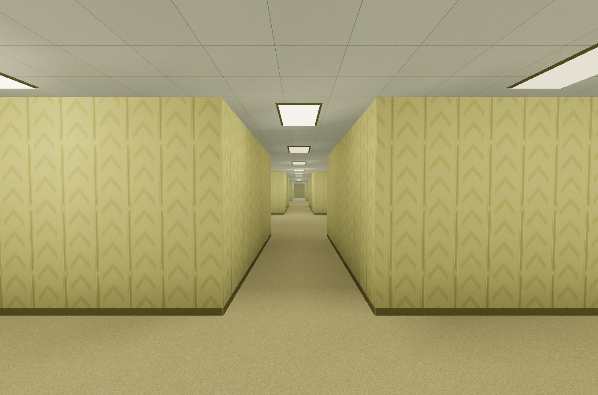

# FLOOR 05

Backrooms esplorabili in prima persona: 26 ambienti collegati su un unico piano, con corridoi, deviazioni e percorsi di ritorno. Tre stili: carta da parati gialla e moquette; ospedale verde a due tonalità; piscine piastrellate con acqua animata.

**[Apri il sito](https://albertogigantelligabriele.github.io/floor-05/)**. Clicca nella scena per catturare il mouse, usa WASD per camminare, Maiusc per accelerare ed Esc per liberare il puntatore. M attiva/disattiva il suono.

Su iPhone/iPad e dispositivi touch: tieni premuto **Cammina** o **Corri**, trascina un altro dito nella scena per guardarti intorno e tocca **Salta**. Su computer il salto usa la barra spaziatrice; i pulsanti restano nascosti sui dispositivi senza touch.

La scena contiene otto gruppi di souvenir, per un totale di 74 oggetti, ciascuno nella stanza della città prevista dalla mappa: Parigi, Londra, Oxford, Varsavia, Milano, Civitavecchia, Roma e Napoli. I modellini hanno tralicci, archi, nervature, finestre e bordi smussati. Le superfici di ogni oggetto vengono analizzate prima della pubblicazione per calcolare appoggi conservativi senza compenetrazioni; non è una simulazione fisica in tempo reale. Le posizioni vengono salvate in `souvenir-placements.js`, evitando il costo del calcolo sul telefono. La mesh resta unica. I cumuli hanno collisioni e lasciano percorribili tutte le stanze. Nessuna porta, schermata iniziale, foto o login. Richiede WebGL 2. Gli strumenti delle foto sono conservati per il futuro e non sono caricati dalla scena.

`node verify-souvenirs.mjs` verifica corrispondenza città-stanza, ingombri, esclusione delle vasche e separazione degli appoggi. `node build-release.mjs` rigenera anche le posizioni dei souvenir.

Verifica dei controlli: `node verify-controls.mjs`. Copre gesti simultanei, interruzioni e salto. La prova su iPhone/iPad fisici resta da completare.

Il rendering usa Three.js r170 incluso nel repository, texture procedurali, illuminazione precalcolata e riflessi semplificati. Nessuna dipendenza da CDN durante l'uso. Licenza Three.js in `vendor/THREE-LICENSE.txt`.

La zona gialla usa carta da parati procedurale ispirata ai riferimenti forniti: doppie righe, chevron consumati e trama tessuta. Moquette a fibre corte, angoli più scuri e neon di intensità diversa. Il ronzio varia con la distanza dalle lampade. Le oscillazioni luminose sono lente e leggere; si fermano con la preferenza di sistema per il movimento ridotto. Nessuna immagine di riferimento viene scaricata durante il gioco.

L'ospedale ha vernice bicolore consumata, linoleum con giunture e segni leggeri, luce fredda non uniforme e ventilazione ovattata. Le piscine hanno piastrelle da 15 cm sulle pareti e da 20 cm sul pavimento, una fascia ceramica integrata nella parete e gocce occasionali con eco. Increspature e riflessi sono confinati ai piani d'acqua delle vasche: pareti e pavimenti asciutti non hanno animazioni acquatiche né riflessi dei neon. Ogni vasca riflette solo lampade visibili dal proprio centro. I suoni cambiano gradualmente attraversando le zone; il suono della piscina sfuma quando si esce. Gli effetti d'acqua sono stilizzati, senza riflessioni ray tracing, per contenere il costo sui dispositivi mobili.

Verifica della pianta: `node verify-layout.mjs`. Il test controlla la raggiungibilità con il raggio del giocatore, le tre zone, la posizione iniziale e le collisioni con pareti e vasche.

Le immagini sotto sono render locali della stessa geometria, degli stessi materiali e shader. Non sono screenshot di una sessione nel browser. Il browser remoto di prova ha WebGL disabilitato: la verifica interattiva grafica resta da completare su un browser compatibile.

[Guida](GUIDA.md)

I passi sintetizzati cambiano sulle tre superfici: ovattati sulla moquette, più secchi sul linoleum e con eco nelle piscine. La cadenza dipende dalla distanza effettivamente percorsa, non dai tasti premuti: nessun passo contro le pareti o durante il salto. L'atterraggio produce un singolo colpo. `node verify-footsteps.mjs` controlla questi comportamenti. Il bilanciamento sonoro va valutato anche dagli altoparlanti del dispositivo usato.

Prima di pubblicare modifiche a materiali, architettura o motore, eseguire `node build-release.mjs` e includere i file generati indicati in `release.json`, insieme a `index.html`. I nomi dei moduli contengono l'hash del contenuto, così ogni aggiornamento carica risorse nuove senza mescolare versioni conservate in cache. Conservare i moduli delle release precedenti per le schede già aperte.
